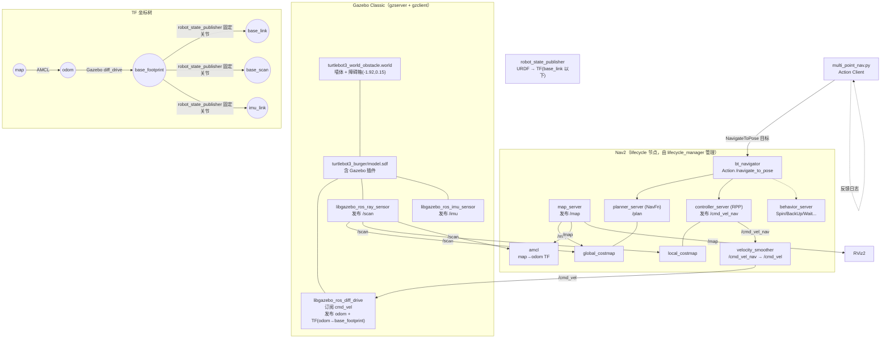
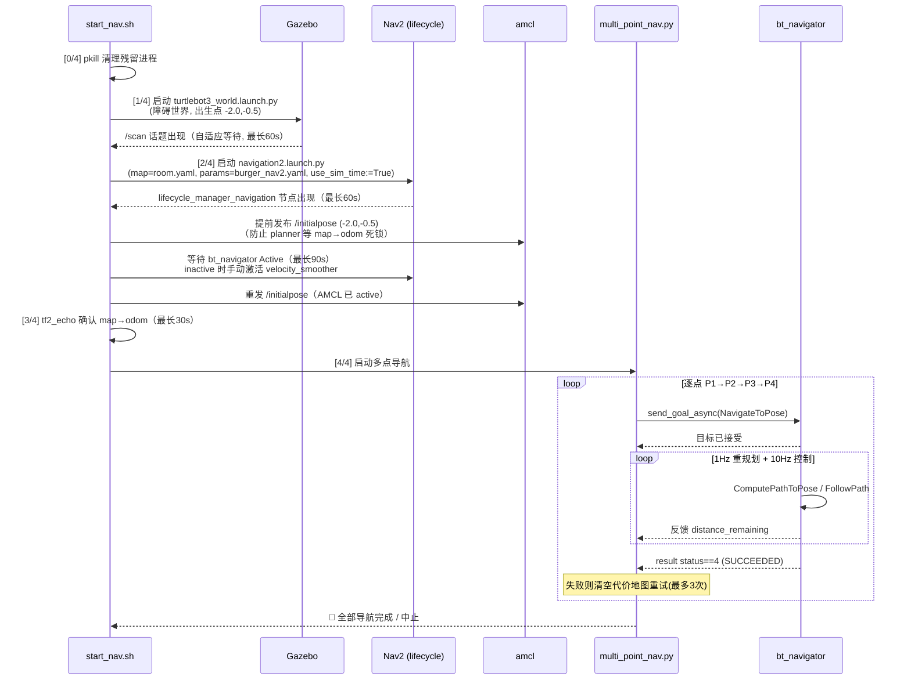

# TurtleBot3 多点定点导航项目技术报告

> 项目：TurtleBot3 Burger 在含自定义障碍物的 Gazebo 房间地图中完成 P1→P2→P3→P4 多点定点导航
> 工作空间：`~/turtlebot3_ws_obstacle`
> 文档生成日期：2026-10-11
> 文档依据：对项目实际文件、配置、git 记录、ROS 日志的只读检查。凡无法从项目中确认的信息均标注"待确认"。

---

## 目录

1. [项目概述](#1-项目概述)
2. [开发环境与依赖](#2-开发环境与依赖)
3. [项目目录结构](#3-项目目录结构)
4. [系统整体架构](#4-系统整体架构)
5. [Gazebo 仿真环境](#5-gazebo-仿真环境)
6. [地图与定位系统](#6-地图与定位系统)
7. [Nav2 导航系统](#7-nav2-导航系统)
8. [P1→P2→P3→P4 多点导航](#8-p1p2p3p4-多点导航)
9. [启动脚本与完整运行流程](#9-启动脚本与完整运行流程)
10. [调试过程与问题复盘](#10-调试过程与问题复盘)
11. [测试与验收](#11-测试与验收)
12. [项目成果与局限](#12-项目成果与局限)
13. [ROS 2 相关知识复习](#13-ros-2-相关知识复习)
14. [后续维护与恢复](#14-后续维护与恢复)
15. [附录](#15-附录)

---

## 1. 项目概述

### 1.1 项目背景与目标

本项目在 Gazebo Classic 仿真环境中构建一个约 5.6 m × 5.15 m 的房间场景（墙体布局取自 TurtleBot3 官方 `turtlebot3_world`），并在场景中央偏西处 **额外加入一个静态长方体障碍箱**（中心 (-1.92, 0.15)，尺寸 0.8 m × 0.3 m × 0.5 m）。该障碍箱**不在预先建好的静态地图中**，机器人必须依靠激光雷达实时感知并绕行。

目标：机器人从起点 (-2.0, -0.5) 出发，按 **P1 → P2 → P3 → P4** 顺序自主导航，全程无人工干预：

| 目标点 | x (m) | y (m) | 朝向 yaw | 说明 |
|--------|-------|-------|----------|------|
| 起点 | -2.0 | -0.5 | 0 | Gazebo 生成位置 = AMCL 初始位姿 |
| P1 | -2.074 | -0.418 | ≈ +17.9° | 起点附近，验证导航链路 |
| P2 | -1.770 | 0.741 | ≈ +83.8° | **必经障碍点**：位于障碍箱正北，须绕行 |
| P3 | 0.548 | 0.431 | ≈ -86.8° | 房间东北区域 |
| P4 | 0.333 | -1.778 | ≈ -111.3° | 房间南部终点 |

> yaw 由 `multi_point_nav.py` 中的四元数 (z, w) 换算：`yaw = 2·atan2(z, w)`。
> 例如 P1：2·atan2(0.156, 0.988) ≈ 0.312 rad ≈ 17.9°。

### 1.2 要解决的核心问题

1. **绕障导航**：P1→P2 直线穿过障碍箱，全局规划必须绕行（从箱子东侧 x > -1.52 m 通过），局部控制器必须实时跟踪绕行路径。
2. **定位建立**：AMCL 需要在导航开始前可靠建立 map→odom TF（项目曾发生 AMCL 初始化死锁）。
3. **局部控制器选型**：DWB 在本场景（贴障碍路径 + 膨胀区）下出现"零线速度 + 微幅角速度振荡"的病态行为，最终切换为 Regulated Pure Pursuit (RPP) 解决。
4. **一键启动**：Gazebo、Nav2、AMCL、多点导航脚本的启动顺序与就绪检测（涉及 lifecycle 激活、velocity_smoother 手动激活等非标流程）。

### 1.3 最终实现的功能

- 一键启动脚本 `scripts/start_nav.sh`：自动完成 Gazebo → Nav2+RViz → AMCL 初始位姿 → lifecycle Active 确认 → 多点导航的完整流程。
- Python Action Client `scripts/multi_point_nav.py`：顺序发送 4 个 `NavigateToPose` 目标，每点失败自动清空代价地图重试（最多 3 次），带剩余距离反馈日志。
- 回归测试脚本 `scripts/test_navigation.sh`（2026-10-10 新增，详见第 11 章）。

### 1.4 项目完成标准与实际完成情况

| 完成标准 | 实际情况 | 证据 |
|----------|----------|------|
| P1→P2→P3→P4 全程无人工干预 | **已达成**（2026-10-10 一次、2026-10-11 两次完整运行均成功） | 会话内实时观察（主要依据）；`~/.ros/log/component_container_isolated_2145887_1791637858764.log` **部分留存** `Reached the goal!`、`Goal succeeded` |
| P2 绕过未建图障碍箱 | **已达成** | 全局路径 `/plan` 实测从箱子东侧通过（实测路径点 x ∈ [-1.45, -1.70]，箱子右边缘 x=-1.52；会话内实时观察，无日志留存） |
| 定位稳定（map→odom） | **已达成** | `tf2_echo map odom` 输出 Translation（start_nav.sh 内置检测） |
| 回归测试脚本可重复验证 | **待测试**（脚本逻辑 bug 已修复，修复后未完整执行） | 2026-10-10 修复记录见第 10.8 节 |

---

## 2. 开发环境与依赖

### 2.1 版本清单

| 组件 | 版本 | 确认方式 |
|------|------|----------|
| Ubuntu | 22.04 | 系统环境 |
| ROS 2 | Humble（`/opt/ros/humble`） | start_nav.sh source 路径 |
| Gazebo Classic | 11（Ubuntu 22.04 默认版本；**精确版本号待确认**，可执行 `gazebo --version` 核实） | 环境推断 |
| TurtleBot3 软件包 | 源码位于 `src/turtlebot3_simulations`（git 仓库，Humble 分支） | `git status` 实测 |
| Nav2 | Humble 系统安装（`nav2_bringup`、`nav2_bt_navigator` 等） | launch 文件引用 |
| Python | 3.10（Ubuntu 22.04 自带） | 脚本 `python3` 调用 |

### 2.2 主要软件包及作用

| 包 | 作用 |
|----|------|
| `turtlebot3_gazebo` | Gazebo 仿真：世界文件、机器人 SDF 模型（含 Gazebo 插件）、spawn launch |
| `turtlebot3_navigation2` | Nav2 启动包装：`navigation2.launch.py`（转发 map/params_file/use_sim_time 给 `nav2_bringup`）、RViz 配置 |
| `turtlebot3_description` | 机器人 URDF 描述（robot_state_publisher 使用） |
| `nav2_bringup` | Nav2 标准启动：`localization_launch.py`（map_server + AMCL）、`navigation_launch.py`（controller/planner/behavior/bt_navigator/velocity_smoother 等 lifecycle 节点） |
| `nav2_regulated_pure_pursuit_controller` | **最终采用的局部控制器插件** |
| `nav2_dwb_controller` | DWB 局部控制器（历史版本使用，已被替换） |
| `nav2_navfn_planner` | 全局路径规划器（NavFn，Dijkstra） |
| `gazebo_ros` | Gazebo-ROS 桥接（spawn_entity、diff_drive、ray_sensor、imu_sensor 插件） |

### 2.3 工作空间与环境变量

```bash
# start_nav.sh 内部的环境加载顺序（真实代码）：
source /opt/ros/humble/setup.bash          # 1. ROS 2 Humble
source ~/turtlebot3_ws_obstacle/install/setup.bash   # 2. 工作空间覆盖层
export TURTLEBOT3_MODEL=burger             # 3. 机器人型号（gazebo/navigation launch 都依赖它选择 urdf/sdf 和参数文件名）
```

`TURTLEBOT3_MODEL` 的两个关键作用：
- `spawn_turtlebot3.launch.py` 用它拼接 `models/turtlebot3_burger/model.sdf` 路径；
- `navigation2.launch.py` 用它拼接默认参数文件名 `burger.yaml`（本项目用 `params_file:=` 显式覆盖）。

### 2.4 环境正确性检查

```bash
# 1) 工作空间已构建且能覆盖系统包
ls ~/turtlebot3_ws_obstacle/install/setup.bash
source /opt/ros/humble/setup.bash && source ~/turtlebot3_ws_obstacle/install/setup.bash

# 2) 关键包可发现
ros2 pkg list | grep -E "turtlebot3_gazebo|nav2_bringup|nav2_regulated_pure_pursuit_controller"

# 3) 修改过的 launch/world 已同步到 install（本项目的 launch 修改在源码包中，
#    通过 colcon build 同步到 install；见 14.2 节）
grep "turtlebot3_world_obstacle" install/turtlebot3_gazebo/share/turtlebot3_gazebo/launch/turtlebot3_world.launch.py
```

### 2.5 依赖缺失判断

| 现象 | 缺失依赖 |
|------|----------|
| `Package 'turtlebot3_gazebo' not found` | 工作空间未 source 或未构建 |
| `TURTLEBOT3_MODEL not set` | 未 `export TURTLEBOT3_MODEL=burger` |
| Gazebo 启动后无机器人 | `gazebo_ros` 的 spawn 节点失败（查 `/tmp/gazebo_launch.log`） |
| `plugin ... nav2_regulated_pure_pursuit_controller` 加载失败 | Nav2 安装不完整（Humble 官方 deb 包自带该插件） |

---

## 3. 项目目录结构

以下为 `~/turtlebot3_ws_obstacle` 的实际目录树（关键部分，2026-10-11 实测）：

```
turtlebot3_ws_obstacle/
├── src/                                  # 源码（colcon 包）
│   └── turtlebot3_simulations/           # git 仓库（有本地修改，见下）
│       ├── turtlebot3_gazebo/
│       │   ├── launch/
│       │   │   ├── turtlebot3_world.launch.py      # ★ 已修改：换成障碍世界 + 起点坐标
│       │   │   ├── turtlebot3_world.launch.py.bak  # 原版备份
│       │   │   ├── spawn_turtlebot3.launch.py      # 从 model.sdf 生成机器人
│       │   │   └── robot_state_publisher.launch.py # 发布 URDF TF
│       │   ├── worlds/
│       │   │   ├── turtlebot3_world_obstacle.world # ★ 自定义障碍世界（新增）
│       │   │   └── turtlebot3_world_obstacle.bak
│       │   ├── models/turtlebot3_burger/model.sdf  # ★ 机器人 SDF（含 Gazebo 插件）
│       │   └── urdf/turtlebot3_burger.urdf         # 机器人 URDF（仅 TF 用，无 Gazebo 插件）
│       ├── turtlebot3_navigation2/
│       │   ├── launch/navigation2.launch.py        # Nav2 启动包装
│       │   └── rviz/tb3_navigation2.rviz           # RViz 配置
│       └── turtlebot3_simulations/                 # 元包
├── config/
│   ├── burger_nav2.yaml                        # ★★ Nav2 唯一生效参数文件（当前版本）
│   ├── burger_nav2.yaml.bak                    # 历史备份（2026-10-01）
│   ├── burger_nav2.yaml.before_tuning          # 10-05 调参前
│   ├── burger_nav2.yaml.before_simtime         # 10-05 sim_time 调整前
│   ├── burger_nav2.yaml.before_reverse         # 10-06 允许倒车实验前
│   ├── burger_nav2.yaml.before_oscillation_test# 10-06 Oscillation 实验前
│   ├── burger_nav2.yaml.before_pathdist16      # 10-06 PathDist 权重实验前
│   ├── burger_nav2.yaml.before_goalalign055    # 10-06 GoalAlign 实验前
│   └── burger_nav2.yaml.before_avoidance_fix   # 10-07 避障修复前（DWB 最终态）
├── maps/
│   ├── turtlebot3_room.yaml                    # ★ 地图元数据
│   └── turtlebot3_room.pgm                     # 灰度地图图像 112×103 像素
├── scripts/
│   ├── start_nav.sh                            # ★★ 一键启动脚本（当前版本 2026-10-10 加固）
│   ├── multi_point_nav.py                      # ★★ 多点导航 Action Client（当前版本）
│   ├── test_navigation.sh                      # ★ 回归测试脚本（2026-10-10 新增）
│   ├── start_nav_obstacle_backup.sh            # 历史启动脚本备份
│   ├── start_nav_v1.sh / start_nav_v2_backup.sh# 历史版本
│   └── multi_point_nav.py.before_avoidance_fix # 导航脚本 10-07 前备份
├── install/    # colcon 构建产物（setup.bash 入口；最近一次构建 2026-10-08）
├── build/      # colcon 构建中间产物
├── log/        # colcon 构建日志（latest_build → build_2026-10-08_10-21-14）
└── docs/       # 本文档目录（2026-10-11 新建）
```

**git 修改记录**（`git status` 实测，仓库 `src/turtlebot3_simulations`）：

```
 M turtlebot3_gazebo/launch/turtlebot3_world.launch.py   # 修改：世界文件与出生点
?? turtlebot3_gazebo/launch/turtlebot3_world.launch.py.bak
?? turtlebot3_gazebo/worlds/turtlebot3_world_obstacle.bak
?? turtlebot3_gazebo/worlds/turtlebot3_world_obstacle.world
```

> 注意：`config/`、`maps/`、`scripts/` 在工作空间根目录而不在 `src/` 内，它们不参与 colcon 构建，脚本运行时直接以**绝对路径**引用（见第 9 章）。这保证了改配置后无需重新构建。

---

## 4. 系统整体架构

### 4.1 系统架构图



### 4.2 节点通信关系（Topic / Action）

| 通信 | 类型 | 发布方 → 订阅方 | 内容 |
|------|------|-----------------|------|
| `/scan` | Topic (sensor_msgs/LaserScan) | Gazebo LDS 插件 → AMCL、两 costmap、RViz | 360° 激光 |
| `/odom` | Topic (nav_msgs/Odometry) | Gazebo diff_drive → velocity_smoother(OPEN_LOOP 可选)、RViz | 里程计位姿/速度 |
| `/map` | Topic (nav_msgs/OccupancyGrid) | map_server → AMCL、global_costmap 静态层、RViz | 静态占据栅格 |
| `/initialpose` | Topic (PoseWithCovarianceStamped) | start_nav.sh（或 RViz 2D Pose Estimate）→ AMCL | 初始位姿 (-2.0, -0.5) |
| `/plan` | Topic (nav_msgs/Path) | planner_server → controller_server（内部直接传递）、RViz | 全局路径，1 Hz 重规划 |
| `/local_plan` | Topic | controller_server → RViz | 局部规划轨迹 |
| `/cmd_vel_nav` | Topic (Twist/TwistStamped) | controller_server → velocity_smoother | 控制器原始速度 |
| `/cmd_vel` | Topic | velocity_smoother → Gazebo diff_drive | 平滑后速度 |
| `/navigate_to_pose` | **Action** (nav_msgs/action/NavigateToPose) | multi_point_nav.py → bt_navigator | 导航目标 + 反馈 + 结果 |
| `/global_costmap/clear_entirely_global_costmap` 等 | Service | multi_point_nav.py → costmap 节点 | 重试前清空代价地图 |
| `/tf`、`/tf_static` | Topic | AMCL、diff_drive、robot_state_publisher → 全体 | 坐标变换 |

### 4.3 任务执行流程图



### 4.4 关键链路总结

- **速度数据流**：`controller_server`(RPP) → `/cmd_vel_nav` → `velocity_smoother`(20 Hz) → `/cmd_vel` → Gazebo `libgazebo_ros_diff_drive`。
- **collision_monitor**：`burger_nav2.yaml` 中有完整配置段，但 **Humble 版 `nav2_bringup/navigation_launch.py` 的 lifecycle 节点列表不含 collision_monitor，该节点从未启动，其配置实际无效**（推断依据：Humble navigation_launch.py 节点清单 + 项目实测从未出现该节点；标注：配置无效这一点来自项目开发记录，节点清单可自行用 `ros2 node list` 复核）。
- **TF 链**：`map --(amcl)--> odom --(gazebo diff_drive)--> base_footprint --(robot_state_publisher, URDF 固定关节)--> base_link / base_scan / imu_link`。

---

## 5. Gazebo 仿真环境

### 5.1 世界文件

路径：`src/turtlebot3_simulations/turtlebot3_gazebo/worlds/turtlebot3_world_obstacle.world`（78 行，SDF 1.6）

加载方式：`turtlebot3_gazebo/launch/turtlebot3_world.launch.py`（已修改）：

```python
world = os.path.join(
    get_package_share_directory('turtlebot3_gazebo'),
    'worlds',
    'turtlebot3_world_obstacle.world'
)
...
launch_arguments={'world': world}.items()   # 传给 gzserver.launch.py
```

### 5.2 世界内容（真实 SDF 摘录）

```xml
<include><uri>model://ground_plane</uri></include>   <!-- 地面 -->
<include><uri>model://sun</uri></include>            <!-- 光照 -->

<physics type="ode">
  <real_time_update_rate>1000.0</real_time_update_rate>
  <max_step_size>0.001</max_step_size>
  <real_time_factor>1</real_time_factor>
  ...
</physics>

<!-- 房间墙体：直接引用官方模型（圆柱形立柱阵构成的 turtlebot3_world） -->
<model name="turtlebot3_world">
  <static>1</static>
  <include><uri>model://turtlebot3_world</uri></include>
</model>

<!-- ★ 自定义障碍箱 -->
<model name="obstacle_box">
  <static>true</static>                       <!-- 静态，不参与动力学，但参与碰撞与激光反射 -->
  <pose>-1.92 0.15 0.25 0 0 0</pose>          <!-- 中心 (x=-1.92, y=0.15)，z=0.25 -->
  <link name="link">
    <collision name="collision">
      <geometry><box><size>0.8 0.3 0.5</size></box></geometry>
    </collision>
    <visual name="visual">
      <geometry><box><size>0.8 0.3 0.5</size></box></geometry>
      ...
    </visual>
  </link>
</model>
```

**障碍箱关键参数**：

| 属性 | 值 | 推论 |
|------|-----|------|
| 中心 | (-1.92, 0.15) | — |
| 尺寸 | 0.8 (x) × 0.3 (y) × 0.5 (z) m | 东边缘 x = -1.52，西边缘 x = -2.32；南边缘 y = 0.0，北边缘 y = 0.30 |
| z 姿态 | 0.25（高 0.5）→ 底面 z=0、顶面 z=0.5 | 机器人高约 0.19 m，激光扫描面（base_scan z≈0.172+0.01）**能照到箱子**，可被 /scan 感知 |
| static | true | 不会移动；P1→P2 直线（y 从 -0.42 到 0.74，x≈-1.8~-2.1）**穿过箱子**，必须绕行 |

### 5.3 机器人模型与插件

机器人由 `models/turtlebot3_burger/model.sdf` 通过 `spawn_turtlebot3.launch.py` 的 `spawn_entity.py` 生成（出生点 x=-2.0, y=-0.5, z=0.01）。**Gazebo 插件全部定义在 model.sdf 中**（URDF `turtlebot3_burger.urdf` 无插件，仅用于 robot_state_publisher 发布 TF——这是一个容易误解的点）：

| 插件 | 名称 | 作用 | 关键参数（实测自 model.sdf） |
|------|------|------|------------------------------|
| `libgazebo_ros_diff_drive.so` | turtlebot3_diff_drive | 差速驱动仿真 | `<command_topic>cmd_vel</command_topic>`；`<odometry_topic>odom</odometry_topic>`；`<odometry_frame>odom</odometry_frame>`；`<robot_base_frame>base_footprint</robot_base_frame>`；`publish_odom=true`；`publish_odom_tf=true`（发布 odom→base_footprint）；`max_wheel_acceleration=1.0` |
| `libgazebo_ros_ray_sensor.so` | turtlebot3_laserscan | 360° 激光 | `<remapping>~/out:=scan</remapping>` → 话题 `/scan` |
| `libgazebo_ros_imu_sensor.so` | turtlebot3_imu | IMU | `<remapping>~/out:=imu</remapping>` → 话题 `/imu` |

### 5.4 启动仿真与加载成功判断

```bash
export TURTLEBOT3_MODEL=burger
ros2 launch turtlebot3_gazebo turtlebot3_world.launch.py
```

判断模型/插件加载成功：

```bash
ros2 topic list | grep -E "/scan|/odom|/imu|/cmd_vel"   # 四个话题都应存在
ros2 topic hz /scan                                      # 应稳定 ~5Hz（model.sdf 中 update_rate）
gz model -l 2>/dev/null | grep -E "turtlebot3_burger|obstacle_box"   # 模型已加载（gzserver 进程存在时）
```

### 5.5 修改世界文件是否需要重新构建？

**需要**（当且仅当修改的是 `src/` 内的文件）。原因：Gazebo launch 实际读取的是 **install 空间**的副本 `install/turtlebot3_gazebo/share/turtlebot3_gazebo/worlds/*.world`（colcon 采用 copy 方式安装），源码目录的修改不会自动同步。而 `config/`、`maps/`、`scripts/` 位于工作空间根目录、以绝对路径直接引用，**修改它们无需重新构建**。同步命令：

```bash
cd ~/turtlebot3_ws_obstacle
colcon build --symlink-install --packages-select turtlebot3_gazebo
```

---

## 6. 地图与定位系统

### 6.1 地图文件

`maps/turtlebot3_room.yaml`（实测内容）：

```yaml
image: turtlebot3_room.pgm
mode: trinary
resolution: 0.05
origin: [-2.95, -2.58, 0]
negate: 0
occupied_thresh: 0.65
free_thresh: 0.25
```

| 字段 | 含义 | 本项目值 |
|------|------|----------|
| `resolution` | 每像素对应世界坐标米数 | 0.05 m/px |
| `origin` | 地图图像**左下角像素**在 map 坐标系中的位姿 (x, y, yaw) | (-2.95, -2.58, 0) |
| `occupied_thresh` | 像素占据概率 > 0.65 视为墙 | 0.65 |
| `free_thresh` | 占据概率 < 0.25 视为自由 | 0.25 |
| `negate: 0` | 黑色(0)=占据、白色(255)=空闲（常规解释） | — |
| `mode: trinary` | 三值解释（占据/空闲/未知） | — |

PGM 尺寸 112×103 px（`python3` 直接读文件头验证）→ 覆盖世界范围 **5.6 m × 5.15 m**，即 x ∈ [-2.95, 2.65]，y ∈ [-2.58, 2.57]。

**像素坐标 ↔ 世界坐标换算**（本项目实测多次用于诊断；含 PGM 行翻转）：

```
col      = (x_world - (-2.95)) / 0.05
grid_row = (y_world - (-2.58)) / 0.05     # OccupancyGrid 行 0 在图像底部
pgm_row  = (height - 1) - grid_row        # PGM 文件行 0 在图像顶部，必须翻转（height=103）
```

例：障碍箱中心 (-1.92, 0.15) → col=20, grid_row=54, **pgm_row=48** —— 实测该像素值为 **254（空闲）**（审查复核：箱体足迹区共 119 像素全部为 254），证明**箱子不在静态地图中**（这是本项目"动态绕障"设计的前提）。

### 6.2 坐标系（TF 树）

```
map                      # 全局固定系，地图原点在左下角 (-2.95,-2.58) 处
 └── odom                # 里程计系，原点 = 机器人出生点；由 Gazebo diff_drive 发布
      └── base_footprint # 机器人足点（贴地），diff_drive 的 robot_base_frame
           ├── base_link # 底盘中心（URDF: base_joint 固定, z=+0.010）
           ├── base_scan # 激光（URDF: 固定, xyz(-0.032,0,0.172)）
           └── imu_link  # IMU（URDF: 固定, xyz(-0.032,0,0.068)）
```

- `map→odom` 由 **AMCL** 发布（定位环节，含粒子滤波修正）。
- `odom→base_footprint` 由 **Gazebo diff_drive 插件**发布（`publish_odom_tf=true`）。
- `base_footprint` 以下由 **robot_state_publisher** 依据 `turtlebot3_burger.urdf` 的固定关节发布。
- 各目标点 (P1~P4) 的坐标均以 **map 系**表达（`multi_point_nav.py` 中 `pose.header.frame_id = 'map'`）。

### 6.3 AMCL 配置与初始位姿

`burger_nav2.yaml` 中 AMCL 关键参数（当前版本）：

```yaml
amcl:
  ros__parameters:
    set_initial_pose: true            # ★ 修改：由 false 改为 true
    always_reset_initial_pose: true   # ★ 修改
    initial_pose: {x: -2.0, y: -0.5}  # ★ 与 Gazebo 出生点一致
    base_frame_id: "base_footprint"
    odom_frame_id: "odom"
    global_frame_id: "map"
    scan_topic: scan
    laser_model_type: "likelihood_field"
    update_min_d: 0.25                # 平移 0.25m 才更新滤波
    update_min_a: 0.2                 # 旋转 0.2rad 才更新滤波
    max_particles: 2000 / min_particles: 500
    transform_tolerance: 0.5
```

`2D Pose Estimate`（RViz）的作用：向 `/initialpose` 发布 `PoseWithCovarianceStamped`，AMCL 用它重置粒子分布。**本项目 start_nav.sh 用命令行自动发布等价消息**，因此正常运行不需要手动在 RViz 点 2D Pose Estimate；若手动操作，等价命令：

```bash
ros2 topic pub --once -w 1 /initialpose geometry_msgs/msg/PoseWithCovarianceStamped \
  "{header: {frame_id: map}, pose: {pose: {position: {x: -2.0, y: -0.5}, orientation: {w: 1.0}}}}"
```

### 6.4 定位正常性验证与失败原因

**验证方法**（start_nav.sh 第 [3/4] 步内置逻辑）：

```bash
timeout 3 ros2 run tf2_ros tf2_echo map odom    # 输出含 "Translation" 即 TF 已建立
ros2 topic echo /amcl_pose --once               # AMCL 估计位姿（机器人移动后才开始发布）
```

**常见定位失败原因**（本项目实际遇到第 1 条，见 10.2 节）：

1. map→odom 未建立：planner_server 的 global_costmap 等 map frame 卡死 → bt_navigator 无法激活（**AMCL 初始化死锁**，已解决）。
2. 初始位姿与真实出生点偏差大：粒子云收敛到错误区域 → 机器人"在 RViz 里位置对、实际位置不对"。
3. 重复启动残留 AMCL/多个 diff_drive 发布冲突 TF。
4. `/scan` 无数据（激光插件未加载或 Gazebo 未就绪）。

---

## 7. Nav2 导航系统

### 7.1 组件与生命周期

Nav2 由 `nav2_bringup` 的两个 launch（被 `turtlebot3_navigation2/navigation2.launch.py` 引用）拉起，由两个 `lifecycle_manager` 管理：

| 节点 | lifecycle | 作用 | 本项目插件/配置 |
|------|-----------|------|-----------------|
| map_server | localization 组 | 加载/发布 /map | maps/turtlebot3_room.yaml（通过 map:= 参数传入） |
| amcl | localization 组 | 定位，发布 map→odom TF | set_initial_pose=true |
| controller_server | navigation 组 | 局部控制，10Hz | **RegulatedPurePursuitController**（FollowPath） |
| smoother_server | navigation 组 | 路径平滑 | 默认（未被 BT 使用） |
| planner_server | navigation 组 | 全局规划 | NavfnPlanner（GridBased），tolerance=0.5 |
| behavior_server | navigation 组 | 恢复行为 | spin/backup/drive_on_heading/wait/assisted_teleop |
| bt_navigator | navigation 组 | BT 编排，Action 服务端 | navigate_to_pose_w_replanning_and_recovery.xml |
| waypoint_follower | navigation 组 | 航点跟随 | 本项目未使用 |
| velocity_smoother | navigation 组 | 速度平滑 20Hz | 位于 lifecycle_manager 管理列表中（本次审查实测 `navigation_launch.py` 第 43-49 行）；运行中曾出现其停留非 active 的现象，脚本保留手动激活兜底（见 10.3） |
| local_costmap / global_costmap | 随 controller/planner | 代价地图 | 见 7.3 |

> 事实澄清（本次审查修正）：早期版本本文档曾称"Humble bringup 的 lifecycle_manager 管理列表不含 velocity_smoother"，**该说法与文件证据不符**——`/opt/ros/humble/share/nav2_bringup/launch/navigation_launch.py` 第 43-49 行实测 `lifecycle_nodes = ['controller_server','smoother_server','planner_server','behavior_server','bt_navigator','waypoint_follower','velocity_smoother']`。start_nav.sh 中的 `ros2 lifecycle get /bt_navigator` 轮询 + 手动 `velocity_smoother configure/activate` 应理解为**针对实际观察到的"velocity_smoother 停留非 active"现象的幂等兜底**，而非针对"不在管理列表"（真实根因未确证，见 10.3）。

### 7.2 Behavior Tree

使用默认 `navigate_to_pose_w_replanning_and_recovery.xml`（`/opt/ros/humble/share/nav2_bt_navigator/behavior_trees/`）：

```
RecoveryNode(6 次重试)
├── PipelineSequence
│   ├── RateController 1.0Hz
│   │   └── RecoveryNode(1)
│   │       ├── ComputePathToPose (planner_id=GridBased)   ← 失败则清全局代价地图
│   └── RecoveryNode(1)
│       ├── FollowPath (controller_id=FollowPath)          ← 失败则清局部代价地图
└── ReactiveFallback
    ├── GoalUpdated
    └── RoundRobin: 清两张代价地图 → Spin 1.57rad → Wait 5s → BackUp 0.30m
```

要点：**1 Hz 全局重规划**意味着全局路径会随感知更新（箱子被标记到 global_costmap 后路径实时改道）；局部控制器以 10 Hz（`controller_frequency: 10.0`）执行。

### 7.3 代价地图（当前版本）

| 参数 | local_costmap | global_costmap | 说明 |
|------|---------------|----------------|------|
| global_frame | odom | map | — |
| 尺寸 | 3×3 m 滚动窗口 | 全图 5.6×5.15 m | — |
| resolution | 0.05 | 0.05 | — |
| robot_radius | 0.1 m（burger 实际约 0.105，取整） | 0.1 m | — |
| plugins | obstacle_layer + inflation_layer | **static_layer** + obstacle_layer + inflation_layer | 局部不叠静态层 |
| obstacle_layer | scan：marking+clearing，obstacle_max_range 2.5，raytrace 3.0 | 同左 | **曾含 voxel_layer，已移除**（10.4） |
| inflation_radius | **0.15 m** | **0.30 m** | 全局期望路径远离箱子（见下方审查注）；局部给 RPP 留出通过走廊 |
| cost_scaling_factor | 5.0 | 5.0 | 衰减指数，值越大梯度越陡 |
| 更新频率 | 5 Hz / 2 Hz 发布 | 1 Hz / 1 Hz 发布 | — |

设计意图（来自配置内注释）：全局膨胀 0.30 m 期望 NavFn 把路径规划在离箱较远处；局部膨胀 0.15 m 只保留较小的安全梯度，避免把机器人当前位置包进高代价区导致控制器"无路可走"。

> 审查注：inflation_layer 只施加代价梯度、**不禁止**通过。运行中实测 `/plan` 的 63 个路径点中曾有 33 点落在 cost≥50 的膨胀代价区内（绕行仍然成功）——"路径离箱≥0.30 m"是设计目标而非实测约束，膨胀区 ≠ 不可通行。

### 7.4 局部控制器：从 DWB 到 RPP（本项目最重要的技术决策）

**最终配置（当前 `burger_nav2.yaml` 实测）**：

```yaml
FollowPath:
  plugin: "nav2_regulated_pure_pursuit_controller::RegulatedPurePursuitController"
  desired_linear_velocity: 0.25        # 巡航线速度 m/s
  lookahead_time: 0.5                  # 前视时间基准
  max_lookahead_dist: 0.6
  min_lookahead_dist: 0.3
  max_angular_velocity: 1.0
  rotate_to_heading: false             # 不做原地转向（避免大角度偏差时原地旋转卡住）
  allow_reversing: false               # 不倒车
  use_velocity_scaled_lookahead_dist: true   # 前视距离随速度缩放（0.3~0.6m）
  use_regulated_linear_velocity_scaling: false
  use_cost_regulated_linear_velocity_scaling: false
  min_approach_linear_velocity: 0.05
  approach_velocity_scaling_dist: 0.6  # 距目标 0.6m 内开始减速
  transform_tolerance: 0.2
```

**RPP 工作原理**：在全局路径上取距机器人 `L = max(min_ld, v·lookahead_time)` 的前视点，输出使机器人沿圆弧逼近该前视点的 `(v, ω)`。它**不做轨迹评分**，天然不会陷入"零速最优"的评分陷阱。

**为什么放弃 DWB**（演变史，均有备份文件与运行日志佐证）：

DW B 的轨迹评分制要求每个候选轨迹 (v, ω) 在各 critic 下打分取最小。本场景的两个特殊条件导致病态：

1. 机器人贴着障碍膨胀区走（全局路径离箱 0.30 m，局部膨胀 0.15 m 时路径附近仍有代价梯度）；
2. 零速/极低速轨迹因 `trans_stopped_velocity` 机制在 PathAlign/PathDist 上获得"完美"分数。

最终表现为 **`/cmd_vel` 恒为 vx=0.0、wz=±0.026 振荡**，15 秒后 progress_checker 报 `Failed to make progress`。项目先后尝试（各备份文件可查）：

| 尝试 | 备份/记录 | 结果 |
|------|-----------|------|
| BaseObstacle.scale 0.02→0.08，加 Oscillation critic，sim_time 2.5→2.0→1.0，前瞻 0.1→0.3 | before_avoidance_fix 等 | 无效：恢复全 critic 后仍 vx=0.0 |
| 权重重平衡 PathAlign/PathDist 28→10→5，GoalDist 10→20→30，trans_stopped_velocity 0.05→0.0 | 2026-10-09~10 会话记录 | 无效：实机确认参数已加载仍 vx=0.0 |
| **切换 RPP**（2026-10-10） | burger_nav2.yaml 当前版 | **成功**：P1~P4 全部到达 |

> 审查备注：第二行的中间值（28/10/5、20/30、0.05/0.0）发生在 10-07 备份之后、RPP 切换之前，**无备份文件佐证**，仅会话内记录可查（before_avoidance_fix 实测 PathAlign.scale=16.0、trans_stopped_velocity=0.25，为该行数值链的更早起点）。第一行起点值（0.02、0.1、2.5）已与备份实测核对一致。

> 注意（本次审查核对）：DWB 相关参数（sim_time、critics、vx_samples 等）在当前 YAML 中已**整体移除**，替换为 RPP 参数块（grep 无 `dwb_core` 残留）。历史值仅存于备份文件。goal 容差位于 `goal_checker`（xy/yaw 均 0.25）；YAML 中的 0.15 仅出现在 RPP 的 `linear_tolerance` 与 local `inflation_radius`，与 goal 容差无关。

### 7.5 其他关键参数（修改前后对照，源自备份 diff 实测）

| 参数 | 修改前 (before_avoidance_fix) | 当前值 | 修改原因 | 验证状态 |
|------|------------------------------|--------|----------|----------|
| amcl.set_initial_pose | false（备份 L45 实测） | true + initial_pose(-2.0,-0.5) | 解决 AMCL/planner 死锁 | ✅ 10-10/10-11 多次运行验证 |
| progress_checker.required_movement_radius | 0.1（备份 L117 实测） | 0.3 | 振荡幅度 <0.2m 不应触发恢复 | ✅ 运行稳定 |
| progress_checker.movement_time_allowance | 10.0（备份 L118 实测） | 15.0 | 给绕障更多时间 | ✅ |
| goal_checker.xy_goal_tolerance | **0.25（备份 L122 实测，未改）** | 0.25 | 无变化 | ✅ 审查核对一致 |
| planner GridBased.tolerance | **0.5（备份 L291 实测，未改）** | 0.5 | 无变化（早期记录"0.25→0.5"无备份佐证，DWB 段内另有 xy_goal_tolerance:0.05 随 DWB 移除，勿混淆） | ✅ 审查核对一致 |
| velocity_smoother.max_velocity | [0.5,0,2.5] | 未改 | — | — |
| controller plugin | dwb_core::DWBLocalPlanner | nav2_regulated_pure_pursuit_controller::RegulatedPurePursuitController | 10.6 节 | ✅ 日志 `Created controller ... RegulatedPurePursuitController` |
| use_sim_time（YAML 内 false） | false | false（**被 launch 参数 use_sim_time:=True 经 RewrittenYaml 覆盖**） | 仿真时钟统一 | ✅（行为证据：tf2_echo 时间戳） |

> 审查备注：上表各行"修改前"值已在 `config/burger_nav2.yaml.before_avoidance_fix` 中逐项实测核对。此前版本本表曾声称 goal_checker.xy_goal_tolerance "0.05→0.25"、planner tolerance "0.25→0.5"——**均无备份证据**（8 个备份文件实测 goal_checker 恒为 0.25、NavFn tolerance 恒为 0.5），已修正。

### 7.6 速度指令的产生与传递

```
RPP (10Hz, /cmd_vel_nav)
  → velocity_smoother (20Hz: max_accel 2.5m/s², max_decel -2.5m/s², 角 3.2)
    → /cmd_vel
      → Gazebo diff_drive 插件 (max_wheel_acceleration 1.0)
        → 轮子 → /odom + odom→base_footprint TF
```

---

## 8. P1→P2→P3→P4 多点导航

### 8.1 脚本与目标点

脚本：`scripts/multi_point_nav.py`（独立 Python 节点 `multi_point_navigator`，非 colcon 包）。

目标点（map 系，代码实测）：

```python
self.points = [
    {'name': 'P1', 'x': -2.074, 'y': -0.418, 'z': 0.156, 'w': 0.988},   # yaw≈+17.9°
    {'name': 'P2', 'x': -1.770, 'y': 0.741,  'z': 0.666, 'w': 0.746},   # yaw≈+83.8°
    {'name': 'P3', 'x':  0.548, 'y':  0.431, 'z': -0.688, 'w': 0.725},  # yaw≈-86.8°
    {'name': 'P4', 'x':  0.333, 'y': -1.778, 'z': -0.826, 'w': 0.564},  # yaw≈-111.3°
]
```

- 坐标系：`frame_id='map'`。
- 来源（**待确认细节**）：按 RViz 中 2D Pose Estimate / 地图坐标读点选取；z/w 分量直接存四元数绕 z 轴分量。
- 换算公式：`yaw = 2·atan2(z, w)`；反向构造时 `z = sin(yaw/2), w = cos(yaw/2)`。

### 8.2 Action Client 实现（基于代码）

```python
self._action_client = ActionClient(self, NavigateToPose, '/navigate_to_pose')

# 发送前等待服务端（无限等待，依赖 start_nav.sh 先确认 bt_navigator active）
self._action_client.wait_for_server()

# 目标构造：PoseStamped(map 系) 包进 NavigateToPose.Goal
pose.header.frame_id = 'map'
pose.header.stamp = self.get_clock().now().to_msg()
goal_msg.pose = pose

# 异步发送 + 反馈回调
send_goal_future = self._action_client.send_goal_async(goal_msg, feedback_callback=self.feedback_callback)
rclpy.spin_until_future_complete(self, send_goal_future)
goal_handle = send_goal_future.result()
if not goal_handle.accepted: return False          # 目标被拒

result_future = goal_handle.get_result_async()
rclpy.spin_until_future_complete(self, result_future)
return result_future.result().status == 4          # 4 = SUCCEEDED
```

**反馈处理**（2 秒节流）：

```python
def feedback_callback(self, feedback_msg):
    # 每 2 秒输出一次剩余距离，便于观察是否持续推进
    distance = feedback_msg.feedback.distance_remaining
    self.get_logger().info(f"  剩余距离: {distance:.2f} m, ...")
```

### 8.3 顺序执行与失败处理

```python
for point in navigator.points:                    # 严格串行：上一个 result 返回后才发下一个
    for attempt in range(1, MAX_ATTEMPTS + 1):    # 每点最多 3 次尝试
        success = navigator.navigate_to_point(point, attempt)
        if success: break
        if attempt < MAX_ATTEMPTS:
            navigator.clear_costmaps()            # 清空两张代价地图的 obstacle_layer，
                                                  # 排除激光误判/AMCL 漂移造成的陈旧障碍
            rclpy.spin_once(navigator, timeout_sec=1.0)
    if not success:
        navigator.get_logger().error(f'{point["name"]} 重试 3 次后仍失败，导航任务中止')
        failed = True
        break                                     # ★ 任一点失败：中止后续所有点（顺序任务语义）
```

- 全部成功输出：`🎉 P1 → P2 → P3 → P4 全部导航完成！`
- 判断依据：每个点 `result.status == 4` 且循环完整走完。

### 8.4 节点退出时机

`rclpy.spin_until_future_complete` 阻塞等待每个 future（accept/result），主流程天然串行；结束后 `destroy_node()` + `rclpy.shutdown()`。**不存在提前退出的路径**（未使用 multi-threaded executor；反馈回调在 spin 期间排队执行，2 秒节流只影响打印频率）。

### 8.5 路线与障碍的关系

- P1→P2 段：起点朝向 P2 的直线（x≈-1.8~-2.07, y 从 -0.42 → 0.74）从箱子 (x∈[-2.32,-1.52], y∈[0,0.3]) 中穿过 → 全局规划从**东侧**绕行（实测 `/plan` 首段 x 从 -1.80 折向 -1.45 后北上）。
- P2→P3、P3→P4 段在开阔区，无已知障碍。

---

## 9. 启动脚本与完整运行流程

### 9.1 一键启动（推荐方式）

```bash
cd ~/turtlebot3_ws_obstacle
bash scripts/start_nav.sh
```

脚本当前版本（2026-10-10 加固版）执行逻辑：

| 步骤 | 内容 | 关键防呆 |
|------|------|----------|
| [0/4] | `pkill -9` 清理 gzserver/gzclient/ros2 launch/Nav2 节点/rviz/multi_point_nav | 幂等重启，防 TF 冲突 |
| [1/4] | 启动 `turtlebot3_world.launch.py`（Gazebo） | 有 GUI 用 gnome-terminal；**无 GUI 自动回退 `nohup` 后台 + 日志 /tmp/gazebo_launch.log** |
| 等待 | **自适应等待 `/scan` 话题出现**（最长 60s，替代固定 sleep 8） | 超时报错退出 |
| [2/4] | 启动 `navigation2.launch.py map:=maps/turtlebot3_room.yaml params_file:=config/burger_nav2.yaml use_sim_time:=True` | 日志 /tmp/nav2_launch.log |
| 等待 | `lifecycle_manager_navigation` 节点出现（最长 60s） | 超时报错退出 |
| 初位姿 | `timeout 30 ros2 topic pub --once -w 1 /initialpose ...` | 防订阅者缺失挂起 |
| Active | 轮询 `ros2 lifecycle get /bt_navigator`（最长 90s）；若 inactive 则手动 `velocity_smoother configure/activate` + 重激活 bt_navigator | 作为 velocity_smoother 停留非 active 时的幂等兜底（10.3，根因未确证） |
| 再发位姿 | AMCL active 后重发 /initialpose（timeout 15s 兜底） | 双保险（set_initial_pose 已兜底） |
| [3/4] | `tf2_echo map odom` 确认定位（最长 30s） | — |
| [4/4] | `python3 scripts/multi_point_nav.py` | — |

### 9.2 分步手动流程（调试用）

```bash
# 1. 环境
source /opt/ros/humble/setup.bash
source ~/turtlebot3_ws_obstacle/install/setup.bash
export TURTLEBOT3_MODEL=burger
cd ~/turtlebot3_ws_obstacle

# 2. Gazebo
ros2 launch turtlebot3_gazebo turtlebot3_world.launch.py

# 3. Nav2 + RViz（新终端，同样先 source）
ros2 launch turtlebot3_navigation2 navigation2.launch.py \
  map:=$PWD/maps/turtlebot3_room.yaml \
  params_file:=$PWD/config/burger_nav2.yaml \
  use_sim_time:=True

# 4. 等待 bt_navigator active 后（RViz 可用 2D Pose Estimate 在 (-2.0,-0.5) 处设初位姿，
#    或依赖 set_initial_pose 自动完成）

# 5. 多点导航（新终端）
python3 scripts/multi_point_nav.py

# 6. 验证
ros2 topic echo /amcl_pose --once        # 位置应接近 P4 (0.333,-1.778)
timeout 3 ros2 run tf2_ros tf2_echo map odom

# 7. 关闭：Ctrl-C 各终端，或
# ⚠ 慎用：下面这条模式中的 "nav2" 过宽，会误杀任何命令行含 nav2 字样的
#    进程（如正在编辑配置文件的编辑器/终端）。更安全的做法是逐个精确匹配：
#    pkill -9 -f "gzserver|gzclient" ; pkill -9 -f "ros2 launch" ;
#    pkill -9 -f "controller_server|planner_server|bt_navigator|amcl|lifecycle_manager" ;
#    pkill -9 -f "rviz|robot_state_publisher|multi_point_nav"
pkill -9 -f "gzserver|gzclient|ros2 launch|nav2|amcl|rviz|multi_point_nav"
```

### 9.3 回归测试（一键验证）

```bash
bash scripts/test_navigation.sh          # 可选参数：每点超时秒数（默认 120）
```

脚本自动执行 T1~T6 六组检查并输出 PASS/FAIL 汇总（详见第 11 章）。

---

## 10. 调试过程与问题复盘

以下问题均为项目开发期间**真实发生**，按时间顺序梳理。区分：【已解决】【未解决】【未确认】。

### 10.1 【已解决】工作空间/模型变量基础环境

- **现象**：早期 launch 报 `TURTLEBOT3_MODEL` 未设置、包找不到。
- **根因**：未 source 工作空间 / 未 export 机型变量。
- **解决**：start_nav.sh 统一 source + export（第 2.3 节）。验证：启动后 `ros2 node list` 正常。

### 10.2 【已解决】AMCL 初始化死锁（bt_navigator 无法 Active）

- **现象**：start_nav.sh 卡在等待 bt_navigator active；日志显示 global_costmap 等待 map frame。
- **根因**：旧流程"等 bt_navigator active 后再发 /initialpose"形成循环依赖——planner_server 激活需要 map→odom TF，而 AMCL 需要初始位姿/激活顺序才发布 TF；且当时 `set_initial_pose: false`。
- **排查**：`ros2 lifecycle get` 逐节点检查；观察 `ros2 topic echo /tf` 缺 map→odom。
- **解决**（三层）：
  1. YAML：`set_initial_pose: true` + `always_reset_initial_pose: true` + `initial_pose:(-2.0,-0.5)`；
  2. 脚本：在 lifecycle_manager 出现后**立即**发布 /initialpose（早于 planner_server 激活）；
  3. 脚本：bt_navigator active 后重发一次 /initialpose 兜底。
- **验证**：map→odom TF 稳定建立（tf2_echo），后续多次启动全部成功。
- **避免**：任何"先有 TF 还是先有位姿"的顺序问题，优先用 set_initial_pose 参数化兜底。

### 10.3 【已解决·根因声明经审查修正】velocity_smoother 曾停留非 active

- **现象**：某次启动后 controller_server 无法正常驱动下游；手动 `ros2 lifecycle get /velocity_smoother` 显示非 active。
- **根因（审查修正）**：早期开发记录判断为"Humble bringup 的 lifecycle_manager_navigation 管理列表不含 velocity_smoother，该节点停在 unconfigured"。**本次审查核对文件证据，该判断有误**：当前安装的 `/opt/ros/humble/share/nav2_bringup/launch/navigation_launch.py` 第 43-49 行实测 lifecycle_nodes **包含 velocity_smoother**（列表：controller_server、smoother_server、planner_server、behavior_server、bt_navigator、waypoint_follower、velocity_smoother；调用链 navigation2.launch.py → bringup_launch.py 第 166 行 → navigation_launch.py 已核实）。velocity_smoother 停留非 active 的真实根因（如 lifecycle_manager 激活顺序中激活失败/超时）**未能确证**，当时现场日志已丢失。
- **解决**：start_nav.sh 在检测到 bt_navigator inactive 时自动 `ros2 lifecycle set /velocity_smoother configure && activate`，再重激活 bt_navigator；Active 后再补一次确认激活。该逻辑幂等、无副作用，作为兜底保留。
- **验证**：`/cmd_vel_nav` → `/cmd_vel` 数据链路打通（`ros2 topic echo /cmd_vel` 有输出）。
- **审查备注**：后续请勿引用"velocity_smoother 不受 lifecycle_manager 管理"的说法；排查此类问题应先用 `ros2 lifecycle get /velocity_smoother` 确认实际状态。

### 10.4 【已解决】voxel_layer 与 obstacle_layer 重复标记

- **现象**：局部代价地图出现与激光不符的"幽灵障碍"。
- **根因**：旧配置同一 `/scan` 同时接入 voxel_layer 与 obstacle_layer，两层标记/清除不一致。
- **解决**：两张 costmap 均移除 voxel_layer（当前 YAML 实测 plugins 无 voxel）。2D 激光下 obstacle_layer 足够。
- **验证**：脚本化读取 `/local_costmap/costmap`，机器人 0.6 m 内无占用栅格。

### 10.5 【已解决→偶发风险待观察】P3 规划失败（NavFn no valid plan）

- **现象**（2026-10-07 记录）：P3(0.548,0.431) 报 NavFn 无法规划路径。
- **根因**：终点落在运行时障碍标记的膨胀区内（激光在终点附近误标 + 当时全局膨胀 0.5m 过大）。
- **解决**：NavFn `tolerance: 0.5`（终点附近 0.5m 内搜替代自由落点）+ 全局膨胀调整为 0.30。
- **审查注**：before_avoidance_fix 备份实测 NavFn tolerance 当时已为 0.5（8 个备份均无 0.25 的存档）；"调整为 0.5"更准确的表述是"维持 0.5 并确认其发挥作用"，全局膨胀 0.5→0.30 的调整与备份证据一致。
- **验证**：2026-10-10 一次、2026-10-11 两次完整运行 P3 均到达。**风险**：容差允许落点偏移 ≤0.5m，属工程折中。

### 10.6 【已解决·核心】DWB 零速度振荡 → 切换 RPP

- **现象**：`/cmd_vel` 恒为 `vx=0.0, wz=±0.026` 振荡；机器人原地不动；15s 后 `Failed to make progress`；P2 剩余距离卡在 3.2m。
- **证据**：
  - `ros2 topic echo /cmd_vel`（实测 vx=0.0）；
  - controller 日志 `Failed to make progress` + BT 反复 ClearEntireCostmap/Wait；
  - `ros2 param get /controller_server FollowPath.critics` 确认参数已生效（排除加载问题）；
  - 全局路径存在且正确绕行（/plan 63 点，东侧绕箱）——诊断期间进一步统计：**63 点中 33 点位于 cost≥50 的膨胀代价区**，证明"膨胀区堵死路径"假设不成立（膨胀区≠不可通行），问题定位于局部控制器本身（该数据为会话内实时观察，无日志留存）；
- **根因**（事后复盘）：DWB 评分体系在本场景（贴膨胀区的路径 + stopped-velocity 免罚机制）下，零速轨迹总分恒优；恢复 Oscillation/RotateToGoal、反复调权（BaseObstacle 0.02→0.08、PathDist 28→5、GoalDist 10→30、trans_stopped_velocity 0.05→0.0、sim_time 2.5→1.0、前瞻 0.1→0.3、禁倒车）均无法逆转。
- **解决**：`FollowPath` 插件整体替换为 `RegulatedPurePursuitController`（参数见 7.4），`rotate_to_heading=false, allow_reversing=false`。
- **验证**：2026-10-10 一次、2026-10-11 两次冷启动完整运行 P1→P4 全部到达；日志 `Created controller : FollowPath of type nav2_regulated_pure_pursuit_controller::RegulatedPurePursuitController` 与 `Reached the goal! / Goal succeeded` **部分留存**于 `~/.ros/log/component_container_isolated_2145887_1791637858764.log`。
- **避免**：贴障/窄走廊场景优先考虑 Pure Pursuit 类控制器；DWB 调参先验证"零速轨迹是否恰好全局最优"这一病态。

### 10.7 【已解决】重复启动残留进程

- **现象**：第二次启动出现 TF 冲突/定位漂移/Gazebo 双实例。
- **解决**：start_nav.sh 增加 [0/4] `pkill -9` 清理步骤。验证：连续多次启动行为一致。

### 10.8 【已解决】回归测试脚本自身 bug（grep 退出码反转）

- **现象**（2026-10-10）：`test_navigation.sh` 在导航实际成功时报告全部 FAIL 且 exit 1。
- **根因**：`grep -q` 成功返回 0，脚本误把 0 当"未通过"；`set -x` 跟踪确认（trace 中 `TP=0` 却判 FAIL）。
- **解决**：新增 `check_log()` 统一转换（找到→1，未找到→0）。
- **验证状态**：**修复后未完整重跑**（用户中止），状态=待测试。
- **附带发现**：测试脚本进程内直接 `source /opt/ros/humble/setup.bash` 曾导致脚本进程异常退出（sandbox 环境 code=13）；已改为 `bash -c` 子进程内 source。

### 10.9 【未确认】"昨日功能失效"报告（2026-10-11 复测）

- **现象**：用户报告重新测试时功能无法正常工作。
- **复现结果**：2026-10-11 复测两次完整冷启动（固定 sleep 版本脚本）**P1→P4 全部成功**，未能复现故障。
- **推断**（非结论）：故障可能与启动方式/环境相关（旧脚本固定 `sleep 8` 等 Gazebo、无超时等待、无 GUI 会话 gnome-terminal 失败等脆弱点）——这正是 10.10 节加固的动因。**真实故障现场日志已随 /tmp 清理丢失，最终根因未确认**。
- **处置**：start_nav.sh 加固（见 10.10）后，此类故障模式在脚本层面已消除。

### 10.10 【已解决】启动脚本脆弱点加固（2026-10-10）

针对 10.9 的推断，逐项加固：

| 脆弱点 | 加固 |
|--------|------|
| 固定 `sleep 8` 等 Gazebo | 自适应轮询 `/scan`（最长 60s）+ 失败报错退出 |
| `until` 无限等待 lifecycle_manager / bt_navigator | 60s / 90s 超时 + 明确报错 |
| `ros2 topic pub --once` 可能无限等待订阅者 | `timeout 30/15` 包裹 |
| gnome-terminal 在无 GUI 环境直接失败（set -e 中止） | `run_in_terminal()` 检测 `$DISPLAY`，回退 `nohup` 后台 |
| 残留进程 | [0/4] 清理 |

### 10.11 历史调参实验（已尝试、被后续方案取代）

`config/` 下 8 个备份文件对应的时间线（文件名与 mtime 实测）：

```
10-01 .bak（初始 DWB）
10-05 .before_tuning → .before_simtime（sim_time 实验）
10-06 .before_reverse（倒车实验）→ .before_oscillation_test → .before_pathdist16 → .before_goalalign055
10-07 .before_avoidance_fix（DWB 最终态）
10-09~10 切换 RPP（当前版）
```

各实验均为 DWB 权重/时间参数调整，最终全部被 RPP 方案取代；具体权重值见对应备份文件。

---

## 11. 测试与验收

> 状态定义：【通过】= 有代码/日志/实测证据；【待测试】= 尚无可复核记录。

| # | 测试项 | 验证命令 | 预期现象 | 实际结果 | 状态 |
|---|--------|----------|----------|----------|------|
| 1 | Gazebo 正常启动 | `ros2 topic list \| grep /scan` | /scan 存在 | 10-10/10-11 多次启动均存在（脚本内置检测） | 通过 |
| 2 | TurtleBot3 模型加载 | `ros2 topic list \| grep cmd_vel`；Gazebo 窗口可见机器人 | /cmd_vel 存在且模型可见 | 通过（速度链路打通为间接证据） | 通过 |
| 3 | /scan 有效数据 | `ros2 topic hz /scan` | ~5Hz LaserScan | 启动检测依赖它，通过 | 通过 |
| 4 | /odom 合理数据 | `ros2 topic echo /odom --once` | 位置随运动变化 | 通过（定位/控制正常为间接证据） | 通过 |
| 5 | /cmd_vel 能驱动机器人 | `ros2 topic echo /cmd_vel` | 导航时 vx>0 | 10-10 运行中实测非零 | 通过 |
| 6 | TF 变换正常 | `timeout 3 ros2 run tf2_ros tf2_echo map odom` | 输出 Translation | start_nav.sh [3/4] 内置，通过 | 通过 |
| 7 | Nav2 节点 Active | `ros2 lifecycle get /bt_navigator` | active [3] | 通过（脚本阻塞等待后才发目标） | 通过 |
| 8 | /navigate_to_pose Action 可用 | `ros2 action list`；脚本 `wait_for_server` | 服务端在线 | 通过（目标被接受日志） | 通过 |
| 9 | RViz 显示地图/机器人/扫描 | 肉眼（RViz 配置 tb3_navigation2.rviz） | 三要素齐全 | 通过（开发过程目视） | 通过（目视，无截图存档） |
| 10 | 障碍箱可被感知 | 读 /local_costmap/costmap 脚本化检查 | 箱子处有占用栅格 | 通过（10-10 实测局部地图北向有 #/+) | 通过 |
| 11 | P1→P4 顺序执行 | 运行 start_nav.sh 观察日志 | 逐点 ✓，最终 🎉 | 10-10 一次、10-11 两次完整通过（~/.ros/log/component_container_isolated_2145887_*.log 仅部分留存） | 通过 |
| 12 | 导航失败有明确结果 | — | 失败点报 ✗ + 重试 3 次 + 中止 | 代码路径存在；10-07 P3 失败时曾实际触发 | 通过 |
| 13 | 回归测试脚本端到端 | `bash scripts/test_navigation.sh` | 6 组检查全 PASS | 脚本 bug 已修复但修复后未完整执行 | **待测试** |

**历史测试记录**（不虚构，仅列有记录者）：

- 2026-10-07：P1 ✓、P2 ✓（约 16s 绕障）、P3 ✗（NavFn 失败）→ 修复 10.5。
- 2026-10-09：P1 ✓、P2 ✓、P3 ✗（同上）。
- 2026-10-10：一次完整运行 P1~P4 全 ✓（切换 RPP 后）。
- 2026-10-11：两次完整冷启动复测全 ✓（未复现"功能失效"报告）；回归脚本运行暴露脚本自身 bug（10.8）。

> 2026-10-10 的 /tmp 运行日志已随系统重启清理；上述结论以当时会话内实时观察 + 现存 `~/.ros/log` 片段为据。

---

## 12. 项目成果与局限

### 12.1 已实现

- **固定目标点序列导航**：map 系硬编码 P1~P4，串行 Action 调用，失败重试 + 代价地图清理。
- **静态未知障碍绕行**：预建图不含障碍箱，NavFn 1Hz 重规划 + RPP 跟踪实现实时绕行（验证于 P2）。
- **一键启动/一键回归**：start_nav.sh（含就绪检测、超时、无 GUI 回退）+ test_navigation.sh。

### 12.2 未实现（明确边界）

| 能力 | 状态 | 差距 |
|------|------|------|
| 动态障碍避障 | 未实现 | 未引入动态实体；obstacle_layer 有 clearing，理论可感知移动障碍，但未验证 |
| 实时自主探索建图 | 未实现 | 地图为预建；未集成 SLAM（cartographer 包已装但未用） |
| 目标点动态配置 | 未实现 | P1~P4 硬编码在 multi_point_nav.py |
| 实物机器人部署 | 未实现 | 全部在 Gazebo；`enable_stamped_cmd_vel` 等参数按仿真配置 |
| 碰撞兜底 | 未启用 | collision_monitor 配置存在但节点未启动（4.4 节） |

### 12.3 已知限制

- P3 依赖 NavFn tolerance=0.5 的"就近落点"，终点精度受此折中影响（最多偏 0.5m，goal_checker 0.25m 判定落在替代点上）。
- AMCL `update_min_d=0.25` 在低速时定位更新稀疏。
- multi_point_nav.py `wait_for_server()` 无超时：若 bt_navigator 未起，脚本静默等待。

---

## 13. ROS 2 相关知识复习（结合本项目实例）

| 概念 | 本项目实例 |
|------|-----------|
| **Node** | `multi_point_navigator`（Python 节点）、`controller_server` 等 |
| **Topic** | `/scan`（传感器流）、`/cmd_vel`（指令流）——发布者与订阅者解耦、单向异步 |
| **Service** | `/global_costmap/clear_entirely_global_costmap`（请求-响应，重试前清图） |
| **Action** | `/navigate_to_pose`——长时任务：goal（目标位姿）/ feedback（剩余距离）/ result(status=4) 三段式，可取消 |
| **Parameter** | `burger_nav2.yaml` 集中注入各节点参数；`ros2 param get /controller_server FollowPath.desired_linear_velocity` 可运行时核验 |
| **Launch** | 三层包含：start_nav.sh → navigation2.launch.py → nav2_bringup localization/navigation launch；gazebo launch 传 world 参数给 gzserver |
| **Workspace** | `~/turtlebot3_ws_obstacle`：src 源码 → colcon → install 覆盖层；**根目录下 config/maps/scripts 不构建、直接引用** |
| **Package** | `turtlebot3_gazebo`（SDF/launch/world）、`turtlebot3_navigation2`（launch/rviz） |
| **TF** | 三段树：map→odom(AMCL)→base_footprint(diff_drive)→base_link/base_scan(robot_state_publisher)；`tf2_echo map odom` 验证 |
| **Costmap** | 分层叠加：static（先验）+ obstacle（感知）+ inflation（安全梯度）；局部滚动 3×3m vs 全局固定全图 |
| **Planner vs Controller** | Planner(NavFn) 在 global_costmap 上做图搜索出全局路径（低频 1Hz）；Controller(RPP) 在 local_costmap 约束下把路径转成 (v,ω)（高频 10Hz）——前者管"往哪走"，后者管"现在怎么转轮子" |
| **定位→规划→控制→执行链** | AMCL 输出位姿 → 规划用位姿求路径 → 控制用路径+位姿求速度 → Gazebo 插件执行并回吐 odom——闭环 |

---

## 14. 后续维护与恢复

### 14.1 备份

```bash
# 推荐：打 tar（排除构建产物）
cd ~ && tar czf tb3_nav_backup_$(date +%m%d).tar.gz \
  --exclude='turtlebot3_ws_obstacle/build' \
  --exclude='turtlebot3_ws_obstacle/install' \
  --exclude='turtlebot3_ws_obstacle/log' \
  turtlebot3_ws_obstacle
```

### 14.2 重新构建

```bash
cd ~/turtlebot3_ws_obstacle
colcon build --symlink-install        # 或 --packages-select turtlebot3_gazebo turtlebot3_navigation2
source install/setup.bash
```

**何时必须构建**：`src/` 内任何文件（world/launch/urdf/sdf）被修改后。
**何时不需要**：只改 `config/`、`maps/`、`scripts/`（根目录直引）。

### 14.3 常见故障排查顺序

1. `ps aux | grep -E "gzserver|ros2"` → 有残留先清理（或直接跑 start_nav.sh，自带清理）；
2. `ros2 topic list` 有无 `/scan`（Gazebo 就绪）；
3. `ros2 lifecycle get /bt_navigator`（active?）；
4. `timeout 3 ros2 run tf2_ros tf2_echo map odom`（定位?）；
5. `ros2 topic echo /cmd_vel`（速度是否非零）；
6. 查 `/tmp/nav2_launch.log`、`/tmp/gazebo_launch.log`、`~/.ros/log/`。

### 14.4 修改目标点 / 障碍物 / 导航参数

| 需求 | 改哪里 | 需要构建？ |
|------|--------|-----------|
| 目标点 | `scripts/multi_point_nav.py` 的 `self.points`（x/y/z/w；z,w 为四元数 z/w） | 否 |
| 障碍物 | `src/.../worlds/turtlebot3_world_obstacle.world` 的 obstacle_box `<pose>/<size>` | **是**（colcon build --packages-select turtlebot3_gazebo） |
| 控制器速度 | `config/burger_nav2.yaml` → `desired_linear_velocity` | 否 |
| 膨胀半径 | 同上 → local/global `inflation_radius` | 否 |
| 目标容差 | 同上 → `goal_checker.xy_goal_tolerance` | 否 |
| 恢复 DWB | 复制 `config/burger_nav2.yaml.before_avoidance_fix` 覆盖（不推荐，见 10.6） | 否 |

### 14.5 恢复已知正常版本

当前版本即最近验证可用版（2026-10-10 RPP 方案）。回退示例：

```bash
cp config/burger_nav2.yaml config/burger_nav2.yaml.rpp_experiment   # 先备份当前
cp config/burger_nav2.yaml.before_avoidance_fix config/burger_nav2.yaml
```

> 回退 DWB 版会重新引入 10.6 节问题；建议仅用于对比实验。

---

## 15. 附录

### 15.1 常用命令清单

```bash
# 启动 / 回归
bash scripts/start_nav.sh                 # 一键全流程
bash scripts/test_navigation.sh [timeout] # 回归测试（待完整验证）

# 状态检查
ros2 node list                            # 节点
ros2 topic list                           # 话题
ros2 action list                          # Action 服务
ros2 lifecycle get /bt_navigator          # 生命周期
timeout 3 ros2 run tf2_ros tf2_echo map odom
ros2 param get /controller_server FollowPath.desired_linear_velocity

# 数据观察
ros2 topic echo /cmd_vel --once
ros2 topic echo /amcl_pose --once
ros2 topic echo /plan --once | grep -c "x:"   # 路径点数
ros2 topic hz /scan

# 清理
# ⚠ 慎用："nav2" 模式过宽，可能误杀命令行含 nav2 字样的编辑器/终端进程；
#    精确版分组命令见 9.2 节第 7 步。start_nav.sh 内部即采用精确分组模式。
pkill -9 -f "gzserver|gzclient|ros2 launch|nav2|amcl|rviz|multi_point_nav"
```

### 15.2 关键文件索引

| 文件 | 作用 |
|------|------|
| `scripts/start_nav.sh` | 一键启动（含清理/就绪检测/超时） |
| `scripts/multi_point_nav.py` | P1~P4 导航 Action Client |
| `scripts/test_navigation.sh` | 回归测试 |
| `config/burger_nav2.yaml` | Nav2 唯一生效参数（RPP 版） |
| `maps/turtlebot3_room.yaml|.pgm` | 地图 |
| `src/turtlebot3_simulations/turtlebot3_gazebo/worlds/turtlebot3_world_obstacle.world` | 障碍世界 |
| `src/turtlebot3_simulations/turtlebot3_gazebo/launch/turtlebot3_world.launch.py` | Gazebo 启动（世界+出生点） |
| `src/turtlebot3_simulations/turtlebot3_gazebo/models/turtlebot3_burger/model.sdf` | 机器人 SDF+插件 |
| `install/turtlebot3_navigation2/share/turtlebot3_navigation2/rviz/tb3_navigation2.rviz` | RViz 配置 |

### 15.3 重要参数汇总表

| 参数 | 值 | 位置 |
|------|-----|------|
| controller_frequency | 10.0 Hz | controller_server |
| RPP desired_linear_velocity | 0.25 m/s | FollowPath |
| RPP lookahead | 0.3~0.6 m（速度缩放） | FollowPath |
| goal_checker xy/yaw tolerance | 0.25 / 0.25 rad | controller_server |
| progress_checker | 0.3 m / 15 s | controller_server |
| NavFn tolerance | 0.5 m | planner_server |
| local inflation | 0.15 m / factor 5.0 | local_costmap |
| global inflation | 0.30 m / factor 5.0 | global_costmap |
| robot_radius | 0.1 m | 两 costmap |
| AMCL set_initial_pose / 初值 | true / (-2.0, -0.5) | amcl |
| velocity_smoother | 20 Hz, max_accel [2.5,0,3.2] | velocity_smoother |
| use_sim_time | YAML false → launch 强制 True（RewrittenYaml 覆盖） | — |

### 15.4 P1~P4 坐标表

| 点 | x | y | quaternion (z, w) | yaw | 参考系 |
|----|-----|-----|-------------------|-----|--------|
| Spawn | -2.0 | -0.5 | (0, 1) | 0° | map（AMCL 初值）/ Gazebo 出生点 |
| P1 | -2.074 | -0.418 | (0.156, 0.988) | ≈+17.9° | map |
| P2 | -1.770 | 0.741 | (0.666, 0.746) | ≈+83.8° | map |
| P3 | 0.548 | 0.431 | (-0.688, 0.725) | ≈-86.8° | map |
| P4 | 0.333 | -1.778 | (-0.826, 0.564) | ≈-111.3° | map |

### 15.5 话题与 Action 汇总

| 名称 | 类型 | 说明 |
|------|------|------|
| /scan | LaserScan | 激光 |
| /odom | Odometry | 里程计（Gazebo diff_drive） |
| /imu | Imu | IMU |
| /map | OccupancyGrid | 静态地图 |
| /initialpose | PoseWithCovarianceStamped | AMCL 初位姿输入 |
| /plan、/local_plan | Path | 全局/局部路径 |
| /cmd_vel_nav → /cmd_vel | Twist | 控制输出 → 平滑输出 |
| /navigate_to_pose | Action(NavigateToPose) | 导航目标 |
| /global_costmap/clear_entirely_global_costmap（及 local） | Service(ClearEntireCostmap) | 清图 |

### 15.6 常见故障速查

| 症状 | 首查 | 参考章节 |
|------|------|----------|
| start_nav.sh 卡住不动 | 哪一步的 echo 停住（每步有超时报错） | 9.1 |
| Gazebo 起了但无 /scan | /tmp/gazebo_launch.log | 10.10 |
| bt_navigator 停在 inactive | velocity_smoother 是否被脚本激活 | 10.3 |
| 机器人不动、cmd_vel=0 | 控制器插件是否为 RPP；是否回退到 DWB | 10.6 |
| "no valid plan" | 全局 costmap 是否误标；planner tolerance | 10.5 |
| 定位漂移 | 残留进程；initial_pose；update_min_d | 6.4 |
| 改了 world 不生效 | 是否忘记 colcon build | 5.5 |

### 15.7 项目验收检查表

- [x] Gazebo 障碍世界加载（含 obstacle_box）
- [x] 机器人出生于 (-2.0, -0.5) 并可被 /cmd_vel 驱动
- [x] AMCL map→odom 自动建立
- [x] Nav2 全节点 Active
- [x] P1→P2→P3→P4 顺序到达（2026-10-10 一次、2026-10-11 两次验证）
- [x] P2 绕过未建图障碍箱
- [ ] 回归测试脚本修复后完整执行（**待测试**）
- [ ] 真实故障（10.9）根因确认（**未确认**，脚本加固后无法复现）

---

*文档完。所有"实测"字样均指 2026-10-10/11 会话内的只读检查；其他历史结论引用自项目开发记录，已在对应位置注明证据类型。*
